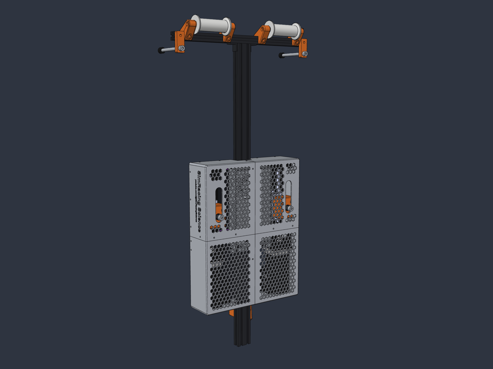

  

# DIY Sim Racing Active FFB Belt Tensioner

[![CC BY-NC-SA 4.0][cc-by-nc-sa-shield]][cc-by-nc-sa]

This repository contains the firmware and hardware integration documentation for an **active Force Feedback (FFB) Seatbelt Tensioner** for sim racing rigs. 

It is designed to **reuse the electronics, controller boards, and mechanical components from the [DIY Sim Racing FFB Pedal project](https://github.com/ChrGri/DIY-Sim-Racing-FFB-Pedal)** while being **100% plug & play compatible with the official [SimHub Belt Tensioner Motion Plugin](https://www.simhubdash.com/diy-belt-tensionner/)**.

---

## 🎬 Demonstration in Action

> 📺 **Watch on YouTube:** [DIY Active FFB Sim Racing Belt Tensioner Showcase](https://www.youtube.com/watch?v=B-jjR-Q3g08)

---

## 🚀 Key Highlights

* **Dual Channel Mechanical Design:** Complete CAD model and printable parts for a two-actuator build (one per shoulder belt) on a single 2040 spine, with power supply and servos in a 3D printed housing. See [Mechanical Design](#%EF%B8%8F-mechanical-design-dual-channel).
* **Reuse Existing DIY FFB Pedal Hardware:** Runs on all **ESP32-S3 ControlBoards** of the DIY FFB Pedal project (V4, V5, V6, V7, PCBA V1.x and PCBA V2.x) and drives the same **Stepperonline iSV57 integrated servo motors**. See [Supported Controller Boards](#-supported-controller-boards).
* **100% SimHub Motion Plugin Compatible:** Communicates via the standard binary SimHub Belt Tensioner protocol (v2.0) at 250,000 baud with no custom SimHub forks required.
* **Sensorless Homing via Modbus Telemetry:** Automatic, physical zero-point calibration using real-time Modbus current feedback from the iSV57 servo without needing fragile external microswitches or optical sensors.
* **Dynamic Speed & Acceleration Scaling:** Built-in hardware multipliers scale SimHub's UI slider limits (36,000 Hz / 100,000 steps/s²) to the full servo potential (**180,000 Hz** pulse frequency and **600,000 steps/s²** acceleration) for instantaneous, snappy braking belt pull.
* **Inactivity Watchdog & Auto-Park:** Automatically eases the harness to a relaxed park position and unpowers the coils after 5 seconds of inactivity.
* **Visual RGB Status Feedback:** Real-time system feedback via the on-board WS2812 RGB LED (Standby, Homing, Active Driving, Idle Parking, and Error states). See [RGB Status LED Guide](docs/LED.md).
* **Dual-Core FreeRTOS Architecture:**
  * **Core 0:** Cyclic Modbus RS485/RS232 telemetry, voltage monitoring, and continuous stall detection.
  * **Core 1:** SimHub binary serial stream decoding and hardware pulse generation using `FastAccelStepper`.

---

## 🛠️ Reusing DIY FFB Pedal Hardware

If you have already built or gathered parts for the [DIY Sim Racing FFB Pedal](https://github.com/ChrGri/DIY-Sim-Racing-FFB-Pedal), you can directly build this belt tensioner using the same ecosystem:

| Component | DIY FFB Pedal Equivalent | Role in Belt Tensioner |
| :--- | :--- | :--- |
| **Controller PCB** | Any ESP32-S3 ControlBoard (see [Supported Controller Boards](#-supported-controller-boards)) | Microcontroller running the motion generator & SimHub protocol. |
| **Actuator** | Stepperonline iSV57T-180 / iSV57-130 integrated servo | High-torque closed-loop servo driving the linear belt puller. |
| **Linear Rail** | 100mm / 150mm linear rail with ball/lead screw (e.g. 10mm pitch) | Converts rotary torque into fast linear harness pull. |
| **Power Supply** | 36V / 48V DC Power Supply (MeanWell or similar) | Powers the iSV57 integrated servo and controller. |
| **RS232 / Modbus** | Onboard RS232 transceiver on ControlBoard | Reads live current and encoder telemetry from the servo. |

### 🔌 Supported Controller Boards

Pre-compiled firmware is released for every ESP32-S3 ControlBoard of the DIY FFB Pedal project. Pick the release archive (`DIY-Sim-Racing-FFB-BeltTensioner_<environment>.zip`) or PlatformIO environment matching your board:

| ControlBoard | Microcontroller | PlatformIO Environment | SimHub Connection |
| :--- | :--- | :--- | :--- |
| **ControlBoard_V4** | ESP32-S3 DevKit | `ControlBoard_V4` | UART USB port (CP2102) |
| **ControlBoard_V5** | ESP32-S3 DevKit | `ControlBoard_V5_without_espnow` | UART USB port (CP2102) |
| **ControlBoard_V6** | ESP32-S3 DevKit | `ControlBoard_V6` | UART USB port (CP2102) |
| **ControlBoard_V7** | ESP32-S3 Zero | `ControlBoard_V7` | Native USB |
| **ControlBoard PCBA V1.x** | ESP32-S3 (pre-assembled PCBA) | `ControlBoard_PCBA_V1X` | Native USB |
| **ControlBoard PCBA V2.x** | LOLIN S3 Mini (pre-assembled PCBA) | `ControlBoard_PCBA_V2X_without_espnow` | Native USB |
| *Generic ESP32 DevKit v1* | *Classic ESP32* | `esp32_devkit` | *UART USB port* |

Pinouts for every board are listed in the [Developer & Hardware Guide](docs/Developer_Guide.md#-hardware-setup--pinouts).

---

## 🏗️ Mechanical Design (Dual Channel)

  

The reference mechanical design is a **dual channel** belt tensioner with one active actuator per shoulder belt:

* **Two JKK60 linear modules** with **iSV57T-130S servos**, mirrored left and right on a vertical 2040 spine that mounts to the rig behind the seat.
* **Belt rollers** on a 2020 crossbar guide both belts over the shoulders down to the carriages.
* **MeanWell LRS-350** power supply between the rails.
* **3D printed four-part housing** with hexagonal vents, belt slots and screwed joints, designed for a 256 mm print bed.

Each actuator is driven by its own ControlBoard and set up in SimHub as a **Dual belt tensioner** (see [SimHub Motion Setup Guide](docs/SimHub_Motion_Setup.md)).

| Resource | Content |
| :--- | :--- |
| 📐 **[Mechanical Design Guide](docs/Mechanical_Design_Dual_Channel.md)** | Layout, housing concept, printed and purchased parts, and assembly order |
| 🖨️ **[Printable parts (`cad/stl/`)](cad/stl/)** | All printed parts as 3MF; the required quantity is part of the file name |
| 🧩 **[CAD assembly (`cad/`)](cad/)** | Complete assembly plus source models (Fusion 360, STEP, IGES) |

---

## 📦 Bill of Materials (BOM)

All components are derived from the [DIY Sim Racing FFB Pedal Ecosystem](https://github.com/ChrGri/DIY-Sim-Racing-FFB-Pedal-Mechanical-Design/tree/main/BOM).

> [!NOTE]
> **Simpler than a pedal!** Unlike an active FFB pedal, the belt tensioner does **not** need a load cell or an ADS1220 ADC amplifier. Physical homing, travel limits, and stall protection are handled sensorlessly through real-time Modbus current and encoder telemetry.

A complete, categorized bill of materials with direct part links, 3D print STLs, and hardware fastener specifications is available here:

👉 **[Complete Bill of Materials (BOM) & Sourcing Guide](docs/BOM.md)**

* **⚡ Electronics:** Any supported ESP32-S3 ControlBoard (V4–V7 or PCBA V1.x / V2.x), iSV57 integrated servo, 36V/48V PSU, wiring & connectors. Self-soldered boards additionally need the SP2323 / SP3232 RS232 transceiver and SR5100 diode (already populated on the PCBAs).
* **🔩 Mechanics:** KK60 ballscrew linear rail, 8mm to 8mm coupler, 3060 adapter plate, lower load cell arm adapter (`8mmLowerAdapter_v3`), 3060 aluminum profile (400 mm).
* **🎗️ Harness & Straps:** 20 cm heavy-duty soft tie-down loops & racing harness connection.
* **🔧 Fasteners:** M4×16, M5×20, M5×25 cylinder head screws, M8×45 threaded rod, and 3030 M5 spring ball nuts.

---

## ⚡ Quick Setup Guide

Getting your active FFB Belt Tensioner up and running takes four steps:

### 1️⃣ Build the Mechanics
Print the parts and assemble the dual channel frame, actuators and housing:
👉 **[Mechanical Design Guide (Dual Channel)](docs/Mechanical_Design_Dual_Channel.md)**

### 2️⃣ Assemble & Wire the PCB
Use any supported ESP32-S3 ControlBoard. Self-soldered boards need the SR5100 diode, XT30 connector, SP2323 / SP3232 RS232 transceiver and ESP32-S3 module; the pre-assembled PCBAs only need the iSV57 servo wired up:
👉 **[PCB Soldering & Assembly Guide](docs/PCB_Assembly.md)**

### 3️⃣ Flash the Firmware
Download the latest pre-compiled release for your board and flash it directly within SimHub using the FFB Pedal Dashboard plugin:
👉 **[Firmware Flashing Guide (Step-by-Step with Screenshots)](docs/Firmware_Flashing.md)**

### 4️⃣ Configure the SimHub Motion Plugin
Import the pre-configured preset or configure the controller in SimHub Motion:
👉 **[SimHub Motion Plugin Setup Guide](docs/SimHub_Motion_Setup.md)**

---

## 📚 Documentation & Technical References

| Document | Topic & Content |
| :--- | :--- |
| 📦 **[Bill of Materials (BOM)](docs/BOM.md)** | Complete parts list, electronics, mechanics, 3D printable adapters, fasteners, and sourcing links. |
| 📐 **[Mechanical Design Guide (Dual Channel)](docs/Mechanical_Design_Dual_Channel.md)** | Dual channel layout, 3D printed housing, printable 3MF parts, purchased parts, and assembly order. |
| 🛠️ **[PCB Soldering & Assembly Guide](docs/PCB_Assembly.md)** | Step-by-step soldering tutorial for ControlBoard_V7 / V6, servo interface wiring, and tensioner simplifications. |
| 💾 **[Firmware Flashing Guide](docs/Firmware_Flashing.md)** | Step-by-step guide to flashing pre-compiled releases using the SimHub FFB Pedal Dashboard USB Flasher. |
| 📖 **[SimHub Motion Setup Guide](docs/SimHub_Motion_Setup.md)** | Step-by-step installation guide with screenshots, axis calibration, and importable `.shmotionoutput` profiles. |
| 🛠️ **[Developer & Hardware Guide](docs/Developer_Guide.md)** | Hardware pinouts, board wiring, `src/Config.h` parameters, and compiling from source with PlatformIO. |
| ⚡ **[Protocol & Command Specification](docs/commands.md)** | Complete specification of binary SimHub packets (`CMD 1`–`15`), serial ASCII commands (`FLASH_SERVO`, `HOME`, `STATUS`), and diagnostic responses. |
| 🏗️ **[Architecture & Execution Reference](docs/reference.md)** | Firmware state machine, sensorless homing workflow, dual-core task design, and step-loss encoder recovery. |
| 💡 **[RGB Status LED Guide](docs/LED.md)** | On-board WS2812 RGB LED color states (Standby, Homing, Active Driving, Parking, Error), pinouts, and brightness tuning. |

---

## ⚠️ Disclaimer & Safety

> [!WARNING]
> **Active force feedback seatbelt tensioners and servos produce high mechanical forces and rapid motions.**
> - Keep hands, loose clothing, and cables clear of linear rails, pulleys, and belt loops during operation.
> - Ensure your rig structure is rigid and securely mounted.
> - Always include a readily accessible emergency power cut-off / kill switch for high-voltage power supplies.
> - Use this project responsibly and at your own risk.

---

## 💖 Supporting the Project

If this project helps bring your sim racing rig to life, consider supporting further open-source development:

---

## 🌟 Star History

---

## 📄 License

This work is licensed under a [Creative Commons Attribution-NonCommercial-ShareAlike 4.0 International License (CC BY-NC-SA 4.0)][cc-by-nc-sa].

[![CC BY-NC-SA 4.0][cc-by-nc-sa-image]][cc-by-nc-sa]

[cc-by-nc-sa]: http://creativecommons.org/licenses/by-nc-sa/4.0/
[cc-by-nc-sa-image]: https://licensebuttons.net/l/by-nc-sa/4.0/88x31.png
[cc-by-nc-sa-shield]: https://img.shields.io/badge/License-CC%20BY--NC--SA%204.0-lightgrey.svg
