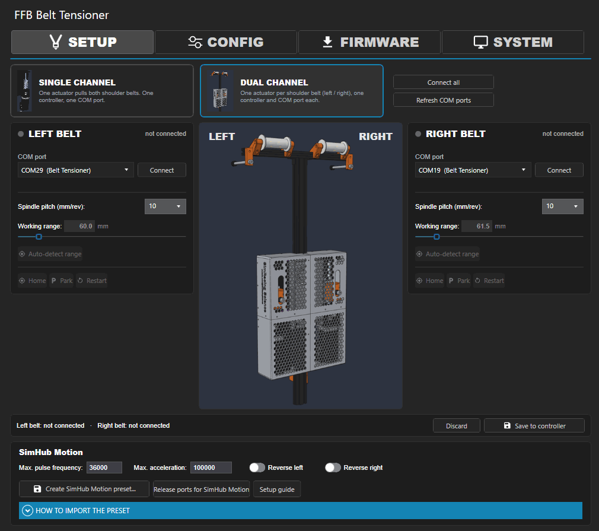
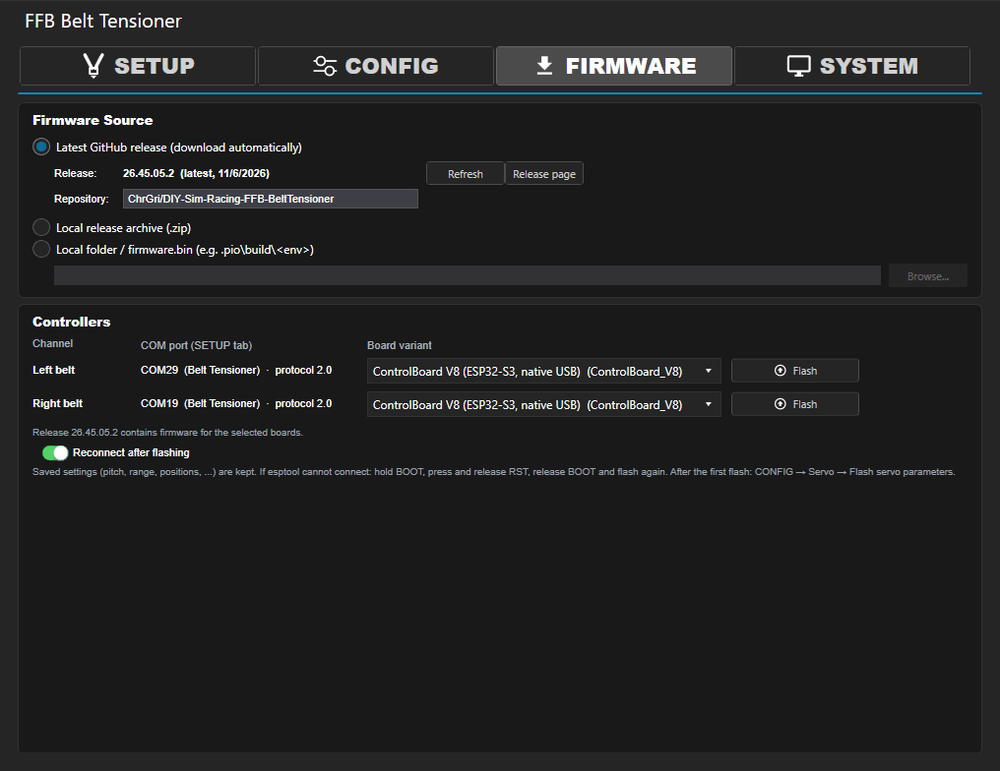
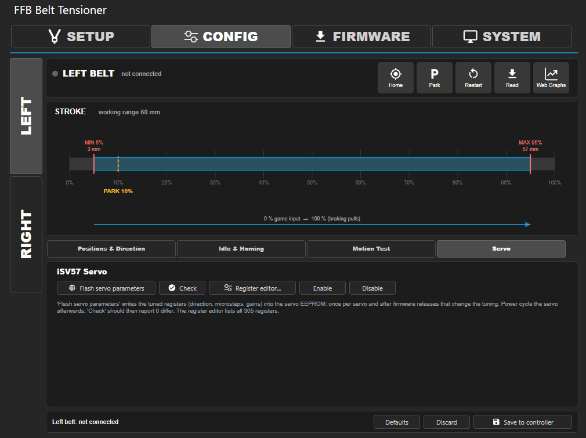
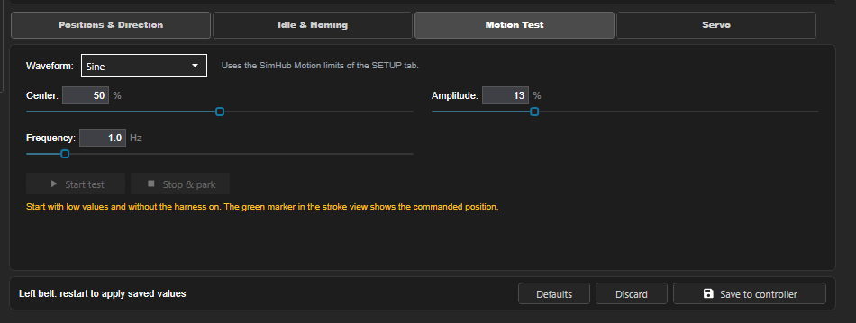
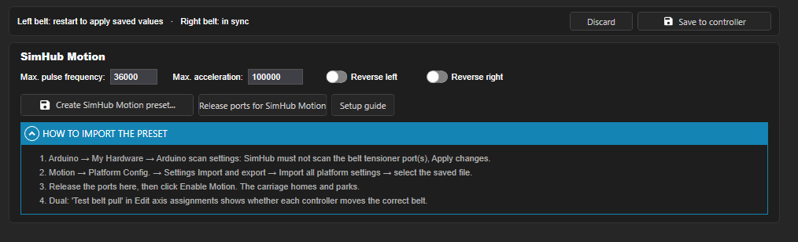

# SimHub Plugin: DIY FFB Belt Tensioner

Set up the belt tensioner completely inside SimHub, no serial terminal needed: flash the firmware, flash the servo, set pitch and working range, test the movement and create the SimHub Motion preset.

<p align="center">
  
</p>

The plugin shows up as **FFB Belt Tensioner** in the left SimHub menu. It supports a **single channel** belt tensioner (one actuator pulls both shoulder belts) and a **dual channel** one (one actuator per shoulder belt). Every channel is one controller board on its own COM port; in a dual setup both belts are connected at the same time.

> [!IMPORTANT]
> A COM port can only be used by one program at a time. **Disable SimHub Motion** while you work in the plugin, and click **Release ports for SimHub Motion** before you enable motion again.

## Installation

1. Download `DiyBeltTensioner.dll` from the [latest release](https://github.com/ChrGri/DIY-Sim-Racing-FFB-BeltTensioner/releases/latest).
2. Close SimHub and copy the DLL into the SimHub folder (usually `C:\Program Files (x86)\SimHub\`).
3. Start SimHub and confirm the question to enable the new plugin. It appears as **FFB Belt Tensioner** in the left menu. If not: *Settings → Plugins*, enable *DIY FFB Belt Tensioner* and *Show in left menu*.

Later updates install themselves: when a new release is out, a banner offers **Update now** (SimHub restarts, admin rights are needed for the SimHub folder).

## First setup in 6 steps

### 1. Connect: SETUP tab

Pick **Single channel** or **Dual channel**. Plug in the controller board(s) by USB and select the COM port of every belt; the list marks belt tensioners, e.g. `COM19 (Belt Tensioner)`, and FFB pedals, e.g. `COM31 (FFB Pedal: Throttle)`. Click **Connect all**.

> [!TIP]
> Boards with a CP2102 USB chip do not tell Windows what they are. Use *SYSTEM → Identify USB-UART boards* to find them.

### 2. Flash the firmware: FIRMWARE tab

<p align="center">
  
</p>

The plugin uses the latest GitHub release. Check the **board variant** of every belt (e.g. *ControlBoard V8*) and click **Flash**. The plugin reconnects automatically afterwards; saved settings are kept.

If flashing fails: hold **BOOT**, press and release **RST**, release **BOOT** and click **Flash** again.

### 3. Flash the servo: CONFIG → Servo

Switch the servo power on, click **Flash servo parameters** and power cycle the servo (switch its power supply off and on). Click **Check**: it should report that all registers match. If not, it lists the differing registers. With a dual setup, repeat this for the other belt (LEFT / RIGHT tabs on the left).

### 4. Pitch and working range: SETUP tab

Select the **spindle pitch** of your linear module (e.g. 5 or 10 mm per revolution). Click **Auto-detect range**: the carriage moves to both end stops (sensorless homing) and takes the measured distance as working range. Then **Save to controller** and confirm the restart.

### 5. Check and test: CONFIG tab

<p align="center">
  
</p>

The stroke view shows the usable range (MIN / MAX safety limits), the park position and the current carriage position. Adjust them under **Positions & Direction** and **Idle & Homing** if needed, then **Save to controller**.

Under **Motion Test** the belt can be moved without a game: *Hold*, *Sine* or *Brake pulse*. Start with low values and without the harness on.

<p align="center">
  
</p>

### 6. SimHub Motion: SETUP tab

<p align="center">
  
</p>

Click **Create SimHub Motion preset...** and save the file. Then:

1. *Arduino → My Hardware → Arduino scan settings*: SimHub must not scan the belt tensioner port(s).
2. *Motion → Platform Config. → Settings Import and export → Import all platform settings* → select the saved file.
3. Back in the plugin: **Release ports for SimHub Motion**, then **Enable Motion** in SimHub. The carriage homes and parks.

More details: [SimHub Motion Setup Guide](../docs/SimHub_Motion_Setup.md).

## The tabs at a glance

| Tab | What it does |
| :--- | :--- |
| **SETUP** | Single / dual layout, one card per belt: COM port, status (servo state, load, voltage, position), spindle pitch, working range with auto-detect, Home / Park / Restart. Save for all belts, SimHub Motion preset. |
| **CONFIG** | Per belt (LEFT / RIGHT): stroke view, **Positions & Direction** (direction, park position, safety limits), **Idle & Homing** (idle delay, homing sensitivity and back-off, homing at boot), **Motion Test**, **Servo** (flash and check the iSV57 parameters, register editor). Buttons: Home, Park, Restart, Read, Web Graphs (live graphs in the browser). |
| **FIRMWARE** | Flash the latest release (or a local `.zip` / build folder), one row per belt with its board variant. |
| **SYSTEM** | Plugin settings (connect at SimHub start, live status, update check), identify USB-UART boards, status messages and the serial console of every belt. |

## Troubleshooting

| Problem | Solution |
| :--- | :--- |
| *COMxx is in use by another program* | Disable SimHub Motion (or close any serial monitor), then connect again. |
| No COM port marked as belt tensioner | CP2102 boards: *SYSTEM → Identify USB-UART boards*. Board without belt tensioner firmware yet: select the port anyway and flash. |
| Settings are greyed out | The firmware on the controller is too old. Flash the latest release. |
| Servo status shows "servo offline" | Check the servo power and the RS232 cable between controller and servo. |
| Saved values have no effect | Settings are applied after a restart of the controller: confirm the restart question or click **Restart**. |
| Homing stops too early / hits the end stop hard | *CONFIG → Idle & Homing*: raise or lower the homing sensitivity. |

<details>
<summary><b>Technical details</b></summary>

* **One actuator per COM port:** the plugin always drives axis 1 of a controller (firmware `NUM_ACTUATORS 1`); it warns when a controller reports two actuators.
* **Port detection:** native USB boards are recognized by their USB product name (`diy_belt_tensioner`); DIY FFB pedals by VID `303A` with PID `8332` clutch, `8333` brake, `8334` throttle, `8331` bridge (product `FFB_Pedal_<role>`). *Identify USB-UART boards* opens CP2102 ports briefly and waits for the belt tensioner greeting (this resets the ESP32 behind the port).
* **Firmware features:** pitch and range need `SET_PITCH` / `SET_RANGE`; direction, positions, idle and homing `SETTINGS` / `SET`; auto-detect `MEASURE_RANGE`; the status display CMD 16; editing servo registers `SERVO_WRITE` / `SERVO_SAVE`; the web graphs switch `WEBGRAPHS ON`. See [docs/commands.md](../docs/commands.md). With older firmware these controls stay disabled.
* **Flashing:** embedded `esptool`; native USB boards via 1200 bps touch (new bootloader COM port), CP2102 boards via DTR/RTS reset.
* **Web Graphs:** without a saved WiFi the controller opens the access point `diy_belt_tensioner`; connect the PC or a phone to it first.

</details>

## Building

Requirements: Windows, SimHub installed, Visual Studio 2022 or the .NET SDK (the project targets .NET Framework 4.8 and references the SimHub DLLs from the installation folder).

```powershell
cd SimHubPlugin
dotnet build -c Release
```

* SimHub must be closed: after building, the DLL is copied into the SimHub folder automatically. Disable with `-p:CopyToSimHub=false`.
* SimHub installed somewhere else: `dotnet build -c Release -p:SimHubPath="D:\SimHub\"` (with trailing backslash).
* The output is `SimHubPlugin\bin\Release\DiyBeltTensioner.dll`.

`Resources\esptool.exe` ([esptool](https://github.com/espressif/esptool), GPL-2.0, Windows build) is embedded into the DLL and extracted to `%TEMP%` when flashing. An `esptool.exe` placed next to `DiyBeltTensioner.dll` in the SimHub folder takes precedence.

## Notes

* Downloaded firmware is cached in `%LOCALAPPDATA%\DiyBeltTensioner\firmware`.
* Settings are stored by SimHub in `PluginsData\Common\DiyBeltTensioner.GeneralSettings.json`.
* *Restart controller* uses the `RESTART` serial command. Firmware releases without it are restarted by reopening the port on CP2102 boards; on native USB boards press **RST** or unplug USB.
* Exposed SimHub properties per channel (`Single`, `Left`, `Right`): `BeltTensionerPlugin.Left.Connected`, `.ComPort`, `.Status`, `.ServoLoad`, `.TestRunning`.
