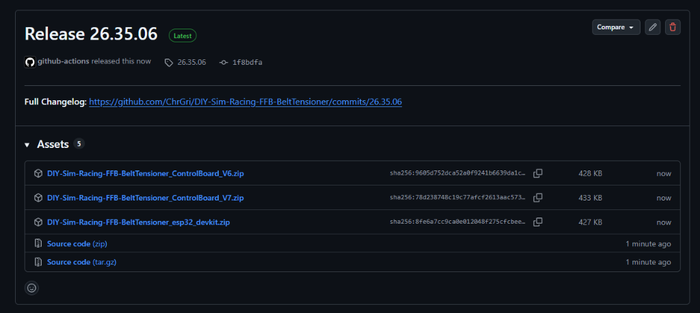
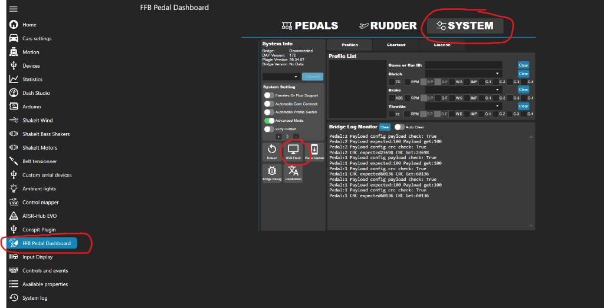
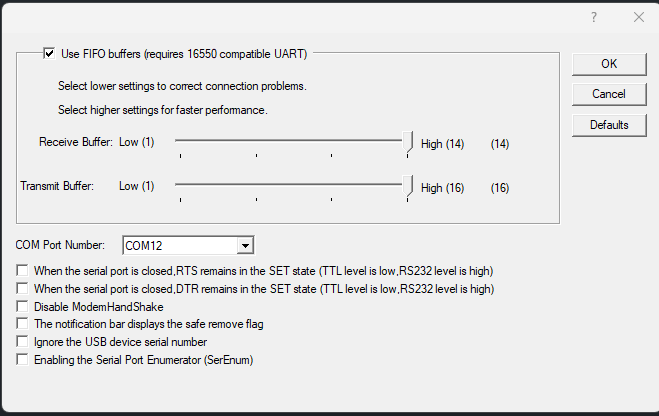
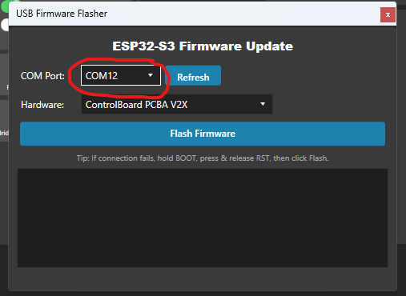
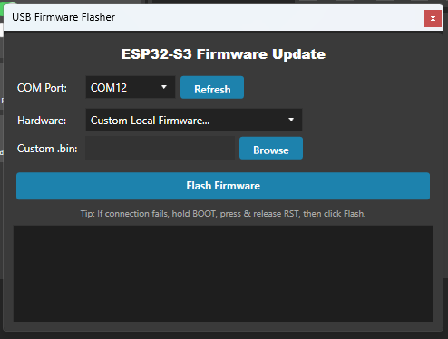
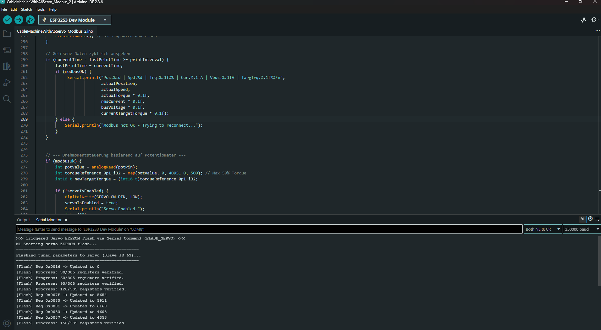

# Firmware Flashing Guide

This guide explains how to flash the pre-compiled firmware to any supported ESP32-S3 ControlBoard (V4, V5, V6, V7, PCBA V1.x, PCBA V2.x) or an **ESP32 DevKit** using the built-in USB Flasher in the **FFB Pedal Dashboard (SimHub Plugin)**.

---

## 🚀 Step-by-Step Flashing Instructions

### Step 1: Download the Release Archive
1. Go to the [Releases](https://github.com/ChrGri/DIY-Sim-Racing-FFB-BeltTensioner/releases) page.
2. Under **Assets**, download the `.zip` archive matching your hardware board:
   * `DIY-Sim-Racing-FFB-BeltTensioner_ControlBoard_V6.zip` (ESP32-S3 DevKit)
   * `DIY-Sim-Racing-FFB-BeltTensioner_ControlBoard_V7.zip` (ESP32-S3 Zero)
   * `DIY-Sim-Racing-FFB-BeltTensioner_esp32_devkit.zip` (ESP32 DevKit v1)
   * `DIY-Sim-Racing-FFB-BeltTensioner_ControlBoard_PCBA_V2X_without_espnow.zip` (ControlBoard PCBA V2.x)
   * `DIY-Sim-Racing-FFB-BeltTensioner_ControlBoard_PCBA_V1X.zip` (ControlBoard PCBA V1.x)
   * `DIY-Sim-Racing-FFB-BeltTensioner_ControlBoard_V5_without_espnow.zip` (ControlBoard_V5, ESP32-S3 DevKit)
   * `DIY-Sim-Racing-FFB-BeltTensioner_ControlBoard_V4.zip` (ControlBoard_V4, ESP32-S3 DevKit)

<p align="center">
  
</p>

---

### Step 2: Unzip the Archive
Extract the downloaded `.zip` file into a local folder on your computer.

> [!IMPORTANT]
> Keep all extracted files (`firmware.bin`, `bootloader.bin`, `partitions.bin`, `boot_app0.bin`) together in the same folder. The flasher requires these companion binary files to be adjacent to `firmware.bin`.

---

### Step 3: Open USB Flash in SimHub FFB Pedal Dashboard
1. Open **SimHub** and select **FFB Pedal Dashboard** in the left menu.
2. Click on the **SYSTEM** tab at the top right.
3. Click on the **USB Flash** button.

<p align="center">
  
</p>

---

### Step 4: Verify COM Port Settings & Select Port

1. Connect your controller board to your PC via USB.
2. Open **Windows Device Manager** (*Geräte-Manager*):
   * Expand **Ports (COM & LPT)** (*Anschlüsse (COM & LPT)*).
   * Right-click your ESP32 COM port (e.g. `COM12` / `CH343` / `CP210x`) and click **Properties** (*Eigenschaften*).
   * Switch to the **Port Settings** (*Anschlusseinstellungen*) tab and click **Advanced...** (*Erweitert...*).
   * Verify that your advanced port settings match the configuration shown below:
     * **Use FIFO buffers:** Enabled / Checked
     * **Receive Buffer:** High (14)
     * **Transmit Buffer:** High (16)
     * Additional flags (RTS/DTR set states, ModemHandshake, etc.): Disabled / Unchecked

<p align="center">
  
</p>

3. In the SimHub **USB Firmware Flasher** window, select your controller's **COM Port** from the dropdown menu (e.g. `COM12`).
4. If your port does not appear, click **Refresh**.

<p align="center">
  
</p>

---

### Step 5: Choose Custom Firmware & Select `firmware.bin`
1. Under the **Hardware** dropdown, select **Custom Local Firmware...**
2. Click the **Browse** button next to **Custom .bin**.
3. Navigate to the extracted folder from Step 2 and select **`firmware.bin`**.

<p align="center">
  
</p>

---

### Step 6: Flash the Firmware
1. Click the **Flash Firmware** button.
2. Wait for the flashing process to complete.
3. The status LED will cycle to indicate startup. Continue with **Step 7** before using the belt tensioner.

> [!TIP]
> **Troubleshooting / Bootloader Mode:**  
> If the flasher fails to connect or times out, put the ESP32 into ROM bootloader mode:
> 1. Hold down the **BOOT** button on the board.
> 2. Press and release the **RST** (Reset) button.
> 3. Release the **BOOT** button.
> 4. Click **Flash Firmware** again.


---

### Step 7: Flash the Servo Registers (required)

The firmware does **not** configure the iSV57 servo automatically. Rotation direction (`Pr0.06`), microsteps per revolution (`Pr0.08`), control loop gains and alarm masks are stored in the servo's own EEPROM and must be written **once** with the `FLASH_SERVO` command. Without this step the servo keeps whatever configuration it had before (factory defaults or settings from a previous project, e.g. the FFB pedal), which can result in homing in the wrong direction, wrong travel scaling or a poor force response.

> [!IMPORTANT]
> Repeat this step whenever you connect a different servo, or when a firmware release changes the tuned servo parameters.

1. Make sure no other program is using the controller's COM port: disable **SimHub Motion** for the belt tensioner, and close any other serial terminal.
2. Open a serial terminal on the controller's COM port with **250000 baud**, for example:
   * the **Arduino IDE** Serial Monitor: select the controller's port under **Tools → Port**, open **Tools → Serial Monitor** and set the baud rate to **250000** (no sketch needs to be uploaded).
   * or the PlatformIO monitor (`pio device monitor -b 250000`).
3. Power the servo on and wait until the controller has connected to it.
4. Send **`FLASH_SERVO`** (any line ending setting works).
5. Wait for the summary. A successful run ends with:
   ```
   [Flash] Successfully saved parameters to servo EEPROM (0x5555)!
   [Flash] Done! Please power cycle the servo to activate all new gains.
   ```

<p align="center">
  
</p>

6. **Power cycle the servo** (switch the servo power supply off and on again) so it loads the new parameters.
7. *Optional:* send **`DIFF_SERVO`** to verify. It reads all parameters without writing anything and should report `0 differ`.
8. Keep the serial terminal open and continue with **Step 8**.

---

### Step 8: Set Spindle Pitch & Working Range (per axis)

The firmware has to know the spindle pitch (mm per motor revolution) and the usable stroke of your linear actuator. Both values are stored in the controller's flash, **separately for each axis**, and survive firmware updates. You can mix actuators: e.g. one axis with a **5 mm** and one with a **10 mm** spindle.

1. In the same serial terminal (250000 baud), send **`CONFIG`**. It prints the current values of each axis, e.g.:
   ```
   Axis 1: spindle pitch 10.00 mm (Config.h), working range 60.00 mm (Config.h) = 19200 steps
     motion: max speed 0.297 m/s (95000 steps/s), acceleration 9.38 m/s^2 (3000000 steps/s^2)
   Change (saved in flash, applied after restart):
     SET_PITCH <axis> <mm>  - spindle pitch, e.g. SET_PITCH 1 5
     SET_RANGE <axis> <mm>  - working range, e.g. SET_RANGE 1 60
     RESET_CONFIG           - delete saved values, use Config.h defaults
   ```
   `(Config.h)` means the firmware default is used, `(saved)` means the value was set by you.
2. If the values do not match your actuator, set them:
   * **`SET_PITCH <axis> <mm>`** - spindle pitch, e.g. `SET_PITCH 1 5`
   * **`SET_RANGE <axis> <mm>`** - usable stroke, e.g. `SET_RANGE 1 60`

   The axis number is `1` (or `2` on a board driving two actuators). In the dual belt setup with one controller board per actuator, every board drives its actuator as axis `1`, so configure each board separately. `.` and `,` are both accepted as decimal separator.
3. **Restart the controller** (unplug USB / power, or press **RST**). The new values are only applied at startup. Send `CONFIG` again to verify; a pending change is reported as `-> changed, restart the controller to apply`.
4. `RESET_CONFIG` deletes the saved values and returns to the firmware defaults.

> [!NOTE]
> Speed and acceleration are defined in m/s and m/s², referenced to a **5 mm** spindle: the maximum of **0.30 m/s** and **9.4 m/s²** uses the full 190 kHz pulse rate on a 5 mm spindle and 95 kHz on a 10 mm spindle. Axes with different pitches therefore move identically, and the SimHub speed and acceleration sliders mean the same on every axis.

5. Close the serial terminal and re-enable SimHub Motion. **Done!** The belt tensioner is ready for use.