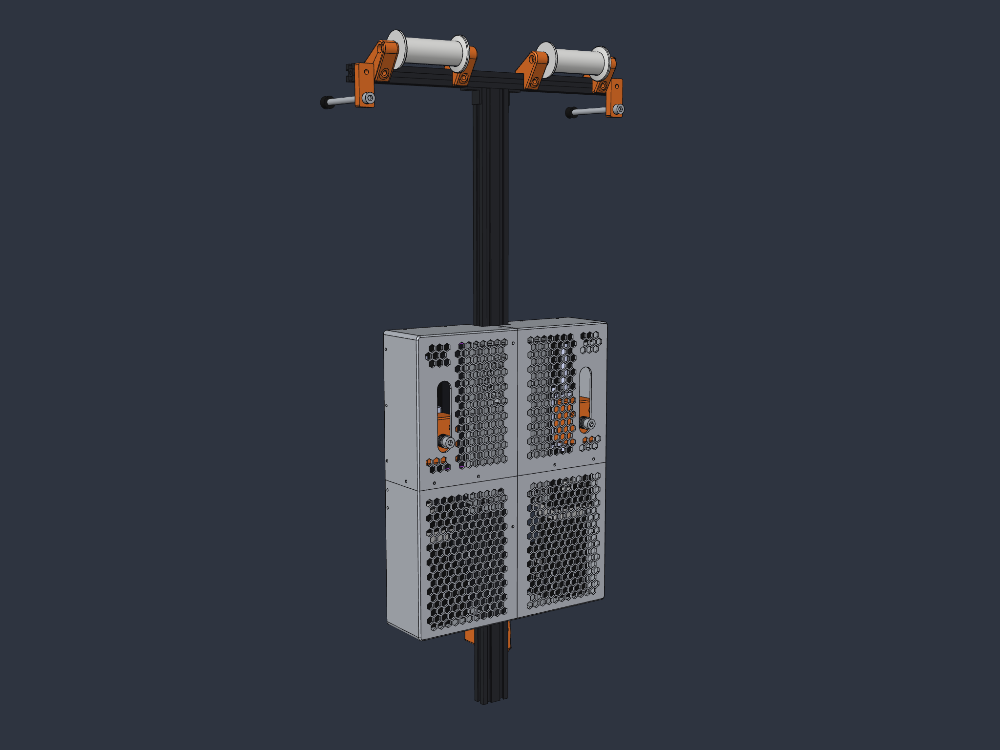

# 🏗️ Mechanical Design — Dual Channel Belt Tensioner

This page describes the **dual channel** mechanical design: one active actuator per shoulder belt, both mounted on a single 2040 spine behind the seat, with the power supply and both servos enclosed in a 3D printed housing.

  

Each actuator is driven by its own ControlBoard and appears in SimHub as its own controller. See the **Dual belt tensioner** variant in the [SimHub Motion Setup Guide](SimHub_Motion_Setup.md).

---

## 📁 Design Files

| Path | Content |
| :--- | :--- |
| [`cad/DIY_BeltTensioner_Assembly.solidcraft`](../cad/DIY_BeltTensioner_Assembly.solidcraft) | Complete assembly (frame, actuators, servos, PSU, rollers, housing, fasteners) |
| [`cad/stl/`](../cad/stl/) | All printed parts as 3MF, ready for slicing; the required quantity is part of the file name |
| [`cad/models/`](../cad/models/) | Source models: Fusion 360 (`.f3d`) plus STEP/IGES exports of the individual parts and purchased components |
| [`cad/DIY_BeltTensioner_Render.png`](../cad/DIY_BeltTensioner_Render.png) | Overview render |

The housing parts are designed for a **256 × 256 mm** print bed. The largest part is 163 × 78 × 209 mm.

---

## 🧭 Layout

* **Spine:** two 2040 V-slot profiles (400 mm each) stacked vertically and joined by the printed `4020_connector`. The 40 mm side faces sideways.
* **Rig mount:** the printed 2040 holder (`BeltTensionerAdapter` + one `RigAdapter` on each side) sits on the back of the spine about 100 mm above its lower end. A M12 threaded rod runs through it into the rig.
* **Crossbar:** a 2020 V-slot profile (400 mm) on top of the spine, fixed with two corner brackets.
* **Belt rollers:** two rollers on the front top edge of the 2020, each held by two `RollerAdapter` parts (one on each side of the roller).
* **Seat distance holders:** two `SeatDistanceHolder` at the ends of the 2020. A M8×100 bolt with an M8 bolt damper rests against the seat back.
* **Actuators:** two JKK60 linear modules (10 mm pitch, 150 mm stroke), mirrored left/right at ±110 mm. The rails face forward. Each module carries an iSV57T servo at the bottom, with the connectors pointing inwards.
* **Belt attachment:** a `BeltToJkkAdapter` on each carriage with an M8×40 bolt and a printed 15 mm spacer (`Distanzhuelse_M8_15mm`, Ø 16 mm with a Ø 20 mm collar at the outer end). The spacer runs through a slot in the housing front. The belt loop sits on it between the housing and the collar, and the collar keeps the loop from sliding off.
* **Power supply:** a MeanWell LRS-350 mounted between the rails with two `Lrs350To2040Adapter`, terminals facing down.
* **Control boards:** two ControlBoards V8 (one per actuator) below the PSU, on the printed `PCB_Halter` on the front of the 2040. The boards stand vertically and are turned 25° about the vertical axis. The screw terminals face outwards toward the servo ports, which leaves room for the servo plugs.

---

## 📦 Housing Concept

The electronics sit on back plates mounted to the spine. A four-part hood slides on from the front and is screwed to the plates and to itself.

* **Upper back plates (2×):** extended versions of the JKK60 rail adapters. The linear modules are mounted on them, and they carry 7 M3 heat-set inserts each for the hood.
* **Lower back plates (2×):** mounted to the back of the 2040 between the servos. Each carries one M3 insert for the hood bottom.
* **Hood (4×):** 3 mm wall, R5 fillets on the long edges, hexagonal vents across the front, belt slots covering the full carriage stroke, and a cable cutout at the bottom. Internal tabs join neighbouring segments with M3 screws and nuts. Both upper side walls carry an engraved [SimRacing Science](https://www.youtube.com/@SimRacingScience) logo (0.8 mm deep).

---

## 🖨️ Printed Parts

All files are in [`cad/stl/`](../cad/stl/).

| Part | File | Qty |
| :--- | :--- | :---: |
| Hood, upper left | `Haube_oben_links_1x.3mf` | 1 |
| Hood, upper right | `Haube_oben_rechts_1x.3mf` | 1 |
| Hood, lower left | `Haube_unten_links_1x.3mf` | 1 |
| Hood, lower right | `Haube_unten_rechts_1x.3mf` | 1 |
| Upper back plate, left | `Rueckplatte_oben_links_1x.3mf` | 1 |
| Upper back plate, right | `Rueckplatte_oben_rechts_1x.3mf` | 1 |
| Lower back plate, left | `Rueckplatte_unten_links_1x.3mf` | 1 |
| Lower back plate, right | `Rueckplatte_unten_rechts_1x.3mf` | 1 |
| Belt adapter on carriage (31 mm) | `BeltToJkkAdapter_31mm_2x.3mf` | 2 |
| Roller | `Roller_2x.3mf` | 2 |
| Roller adapter | `RollerAdapter_4x.3mf` | 4 |
| Belt roller bracket | `BeltRoller_2x.3mf` | 2 |
| 2040 holder, profile side | `2040Holder_BeltTensionerAdapter_1x.3mf` | 1 |
| 2040 holder, rig side (left and right, identical) | `2040Holder_RigAdapter_2x.3mf` | 2 |
| 2040 connector | `4020_connector_1x.3mf` | 1 |
| PSU adapter | `Lrs350To2040Adapter_2x.3mf` | 2 |
| Seat distance holder | `SeatDistanceHolder_2x.3mf` | 2 |
| ControlBoard holder | `PCB_Halter_1x.3mf` | 1 |
| Belt spacer M8, 15 mm | `Distanzhuelse_M8_15mm_2x.3mf` | 2 |

> [!TIP]
> The parts are exported in their installed orientation. Rotate them onto a flat face in the slicer. Print the hood segments front-face down so the hexagonal vents need no supports. Print the ControlBoard holder on its flat back (the side that rests on the 2040). It needs no supports in that orientation. Print the belt spacers standing on their collar.

---

## 🔩 Purchased Parts

### Frame & Mounting

| Component | Qty |
| :--- | :---: |
| 2040 V-slot profile, 400 mm | 2 |
| 2020 V-slot profile, 400 mm | 1 |
| 2020 corner bracket | 2 |
| M12 threaded rod (~150 mm) with nuts | 1 |
| Ball bearing 625-2Z (5 × 16 × 5 mm), two per roller | 4 |
| M5×20 cylinder head screw, roller axles | 4 |
| M8×100 cylinder head screw | 2 |
| M8 bolt damper (rubber bumper) | 2 |

### Actuators & Power

| Component | Qty |
| :--- | :---: |
| JKK60 linear module, 10 mm pitch, 150 mm stroke (`JKK60-10-P-150-A1-F4-M`) | 2 |
| StepperOnline iSV57T-130S integrated servo | 2 |
| 8 mm to 8 mm shaft coupler | 2 |
| MeanWell LRS-350, **36 V or 48 V** variant (see note) | 1 |
| ControlBoard (one per actuator, see [Supported Controller Boards](../README.md#-supported-controller-boards)) | 2 |

> [!NOTE]
> The CAD model uses the LRS-350-**24** STEP file. All LRS-350 variants share the same 215 × 115 × 30 mm housing and mounting holes, so use the **LRS-350-36** (or LRS-350-48) recommended in the [BOM](BOM.md) for the iSV57 servos.

### Belt Attachment

| Component | Qty |
| :--- | :---: |
| M8×40 cylinder head screw | 2 |
| Soft tie-down loop (20 cm) | 2 |

### Housing Fasteners

| Component | Qty | Use |
| :--- | :---: | :--- |
| M3 heat-set insert (for Ø 4.2 mm holes) | 20 | 14 in the upper back plates, 2 in the lower back plates, 4 in the ControlBoard holder |
| M3 cylinder head screw | 16 | Hood to back plates |
| M3×6 cylinder head screw | 4 | ControlBoards to their holder |
| M3 screw + nut | 10 | Hood segments to each other |

### Profile Fasteners

All printed parts are screwed into the profile slots with M5 cylinder head screws (DIN 912) and M5 T-nuts for 20-series slots. The lengths below are modelled in the CAD assembly.

| Component | Qty | Use |
| :--- | :---: | :--- |
| M5 T-nut (20-series slot) | 42 | One per M5 screw below |
| M5×10 | 4 | Corner brackets (2020 to 2040) |
| M5×12 | 16 | `4020_connector` (4), lower back plates (4), PSU adapters into the 2040 side slots (4), ControlBoard holder (4) |
| M5×16 | 18 | Roller adapters (8), seat distance holders (2), upper back plates (8) |
| M5×20 | 4 | 2040 holder (`BeltTensionerAdapter`) |
| M4×10 | 4 | PSU adapters to the power supply |

> [!NOTE]
> The linear modules are fastened to the upper back plates with M4 screws, and the belt adapters to the carriages with M5 screws; choose those lengths to suit the module. Because the belt adapter is 31 mm deep, the four M5 screws between `BeltToJkkAdapter` and carriage are 11 mm longer than with the original 20 mm adapter.

---

## 🛠️ Assembly Order

For a detailed walkthrough with a CAD picture for every step, see the **[Build Instructions](Build_Instructions.md)**.

1. Join both 2040 profiles with the `4020_connector` and mount the 2020 crossbar with the corner brackets.
2. Mount the 2040 holder and the M12 rod, and fix the spine to the rig.
3. Press two 625-2Z bearings into each roller, fit the adapters with M5×20 axle screws, then mount the rollers and the seat distance holders to the 2020.
4. Screw the linear modules onto the upper back plates, flange the servos to the modules and mount the plates to the back of the 2040.
5. Mount the lower back plates and the PSU with its two adapters. Screw the ControlBoard holder to the front of the 2040 before fitting the boards: the boards cover its M5 screws.
6. Fit the belt adapters, spacers and M8 bolts to the carriages and route the belts over the rollers.
7. Join the four hood segments on the bench with M3 screws and nuts, slide the complete hood on from the front and screw it to the back plates (M3 inserts pressed in beforehand).
