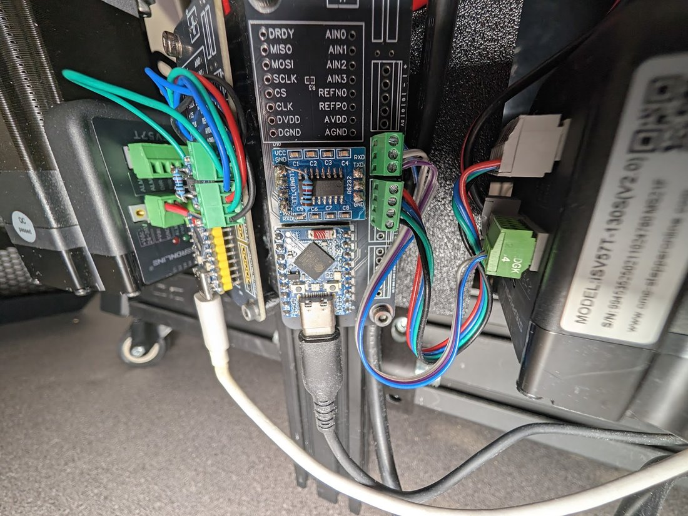

# 🛠️ Control PCB Assembly & Soldering Guide (Belt Tensioner)

This guide walks you through assembling and soldering the controller PCB specifically tailored for the **DIY Active FFB Belt Tensioner**. The current board is the **ControlBoard V8** (ESP32-S3 Zero, see below); the older `ControlBoard_V7` (ESP32-S3 Zero) and `ControlBoard_V6` (ESP32-S3 DevKit) are described further down.

---

## ControlBoard V8 (Belt Tensioner)

The V8 has no power circuit: the servo is supplied directly from the power supply, the board is powered via USB-C. **For the belt tensioner, only two modules are needed:**

| ✅ Solder | ❌ Leave empty (pedal only) |
| :--- | :--- |
| **ESP32-S3 Zero** (U13) | **ADS1220** load cell ADC |
| **SP3232 / MAX3232 RS232 module** (U10) | **RC filter** (R1, R2, C1) |
| **10 kΩ pull-up resistor (R3)** on the SP3232 module | **Load cell** screw terminal |
| **RS232** screw terminal (`RX` `GND` `TX`) | **Expansion** screw terminal |
| **Servo** screw terminal (`P+` `P−` `D+` `D−` `A+` `A−`) | |

Follow the [pedal PCB V8 soldering guide](https://github.com/ChrGri/DIY-Sim-Racing-FFB-Pedal-Mechanical-Design/tree/main/Soldering_V8) for these parts and skip the ADS1220, the RC filter and the load cell wiring.

> [!IMPORTANT]
> **10 kΩ pull-up (R3):** solder it between the outer pins of the 4 pin TTL row of the SP3232 module, `VCC` (3.3 V) and `RXD` (ESP32 TX). Without it, the SP3232 sends a break to the servo while the ESP32 boots, and a servo switched on at the same time starts with its red alarm LED on. Details and measurements: [SP3232 pull-up](https://github.com/ChrGri/DIY-Sim-Racing-FFB-Pedal-Mechanical-Design/blob/main/Soldering_V8/SP3232_PullUp.md).

Wiring of the servo signals and the RS232 port: see the terminal tables in the [pedal guide](https://github.com/ChrGri/DIY-Sim-Racing-FFB-Pedal-Mechanical-Design/tree/main/Soldering_V8) (`RX`/`TX` crossed to the servo debug port).

---

## ControlBoard V7 / V6

## ⚡ Quick Summary: How the Belt Tensioner Differs from the Pedal

Because the Belt Tensioner operates via position control and sensorless Modbus telemetry instead of a load cell, **more than half of the components from the pedal PCB are omitted**. This makes assembling the board much faster and easier!

| ✅ Required & Populated (Belt Tensioner) | ❌ Omitted & Skipped (Pedal Only) |
| :--- | :--- |
| **SR5100 Schottky Diode** (Power input protection) | **ADS1220 ADC Chip** (Load cell amplifier) |
| **XT30 Power Connector** (Angled male DC input) | **RC Filter Network** (100Ω resistors & 0.1µF caps) |
| **SP2323 / SP3232 RS232 Transceiver** | **FR120N MOSFET** (Brake chopper circuit) |
| **RS232 Charge-Pump Caps** (0.1 µF / 104) | **8Ω / 10Ω 5W Brake Resistor** (Load dump) |
| **ESP32-S3 Zero Board** (Microcontroller) | **Load Cell Screw Terminals** |
| **Pulse / Dir / Alm Servo Interface Headers** | |
| **Modbus Telemetry Port** (5-pin debug interface) | |

> [!TIP]
> Base Soldering Guide: This guide builds upon the original pedal documentation:  
> 👉 **[DIY FFB Pedal Soldering Guide (Soldering_V7)](https://github.com/ChrGri/DIY-Sim-Racing-FFB-Pedal-Mechanical-Design/tree/main/Soldering_V7)**

---

> ℹ️ **Affiliate Disclosure:**  
> Some links in this document are affiliate links (marked with an asterisk `*`). When you purchase through these links, a small commission may be paid to help support open-source development and hardware prototyping—at no additional cost to you. Thank you for your support!

---

## 💡 Soldering Tips & Recommended Tools

A good soldering iron makes your life easier:
* I like the portable **[TS80*](https://s.click.aliexpress.com/e/_c33CYe8n)** and **[TS101*](https://s.click.aliexpress.com/e/_opJpOtW)** soldering irons.
* Helpful soldering tutorial video: 📺 **[Soldering tips can be found here](https://www.youtube.com/watch?v=DfC5FBsud7o)**.

---

## 📋 Required Components for Assembly

For direct purchasing links, see the **[Bill of Materials (BOM)](BOM.md)**.

| Component | Role in Belt Tensioner |
| :--- | :--- |
| **Control PCB** | `ControlBoard_V7` (ESP32-S3 Zero) or `ControlBoard_V6` (ESP32-S3 DevKit) |
| **ESP32-S3** | Microcontroller running the motion engine and SimHub binary protocol |
| **SP2323 / SP3232** | RS232 transceiver IC for Modbus communication with the iSV57 servo |
| **0.1 µF Capacitors (104)** | Charge-pump capacitors for the RS232 transceiver |
| **SR5100 Schottky Diode** | Reverse-polarity and inductive flyback protection on DC power input |
| **XT30 Connector (Angled)** | High-current DC power input connector (male, angled) |
| **2.54 mm Screw Terminals / Pins** | Connections for `PUL+`, `DIR+`, `ALM`, and Modbus `TX`/`RX` |
| **AWG 18 Wire** | DC power lines between PSU, PCB, and iSV57 servo |
| **AWG 30 Wire** | Signal and logic wiring |

---

## 🔧 Step-by-Step Soldering Instructions

### Step 1: Power Input Circuit (XT30 & SR5100 Diode)
1. **SR5100 Diode:** Solder the SR5100 Schottky diode. Pay close attention to orientation: the white/silver ring on the diode body corresponds to the cathode line on the PCB silkscreen.
2. **XT30 Connector:** Solder the angled male XT30 connector into the power input pads. Ensure positive (`+`) and negative (`-`) align with the silkscreen.
3. ❌ **Do NOT install the MOSFET or Brake Resistor:** Unlike the pedal, the belt tensioner does not generate significant regenerative kickback during normal operation. Leave the FR120N MOSFET and power resistor pads unpopulated.

### Step 2: RS232 Modbus Transceiver (SP2323 / SP3232)
The RS232 transceiver enables the ESP32 to query the iSV57 internal drive for real-time current, encoder position, and error codes:
1. Align the notch or dot on the SP2323/SP3232 IC with Pin 1 on the PCB silkscreen.
2. Solder the IC pins.
3. Populate the required charge-pump decoupling capacitors (`0.1 µF / 104`) adjacent to the transceiver IC.

### Step 3: Skip the Load Cell Circuit (ADS1220)
* ❌ **Do NOT solder the ADS1220 ADC chip.**
* ❌ **Do NOT solder the RC filter resistors or capacitors.**
* The belt tensioner relies on **sensorless stall homing** and encoder feedback; physical load cell measurement is not used.

### Step 4: ESP32-S3 Microcontroller
* **ControlBoard_V7:** Solder the female header strips or solder the **Waveshare ESP32-S3 Zero** directly to the PCB pads. Ensure the USB-C port faces outward for easy firmware flashing.
* **ControlBoard_V6:** Solder female pin headers for the **ESP32-S3 DevKitC-1** board.

### Step 5: Wiring the iSV57 Integrated Servo Motor

You only need two wiring interfaces between the PCB and the iSV57 motor:

#### A. Motion Control Signals (Screw Terminals / Pin Header)
| Board Signal | Target Pin on iSV57 Servo | Description |
| :--- | :--- | :--- |
| **PUL+ / STEP** | `PUL+` (Pulse) | High-speed motion step pulses |
| **DIR+ / DIR**  | `DIR+` (Direction) | Motion direction signal |
| **ALM / FAULT** | `ALM+` (Alarm) | Servo error / trip detection |
| **GND / COM**   | `PUL-` / `DIR-` / `ALM-` | Common ground for optocouplers |

#### B. Modbus Telemetry (5-Pin Debug Connector Cable)
Connect the female 5-pin debug cable from the iSV57 tuning port to the PCB RS232 port:
| ControlBoard Pin | iSV57 5-Pin Debug Port | Wire Function |
| :--- | :---: | :--- |
| **TX** | Pin 2 (RX) | ESP32 transmits Modbus queries to servo |
| **RX** | Pin 3 (TX) | ESP32 receives encoder & current telemetry |
| **GND** | Pin 1 (GND) | Logic ground reference |

---

## ⚡ Pre-Power Check & Verification

Before plugging into your 36V / 48V power supply:

1. 🔍 **Visual Inspection:** Inspect all solder joints under good light for solder bridges, particularly across adjacent pins of the SP2323/SP3232 IC.
2. ⚡ **Continuity & Short-Circuit Test:** With a multimeter in continuity/resistance mode:
   * Verify there is **NO short circuit** between `+` and `-` on the XT30 power connector.
   * Verify `GND` is properly continuous between the XT30 input, ESP32 ground pins, and the servo common ground.
3. 🔌 **USB Flashing Test:** Plug in the ESP32 via USB-C *without* high-voltage PSU connected. The board should enumerate as a serial COM port in Windows Device Manager.
4. 💡 **RGB LED Verification:** Once flashed, the on-board WS2812 LED will display the current system state (see [RGB Status LED Guide](LED.md)).
