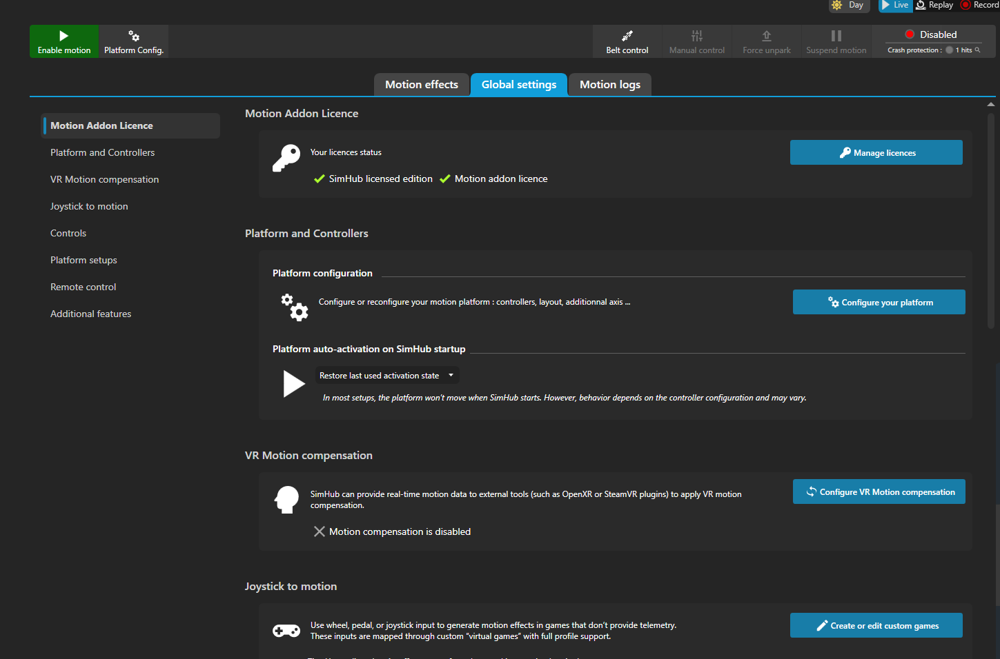
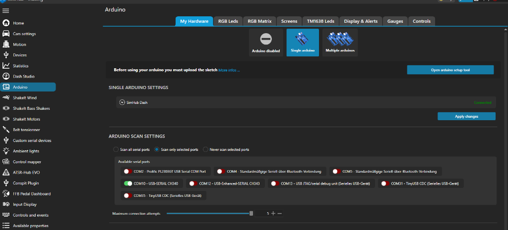
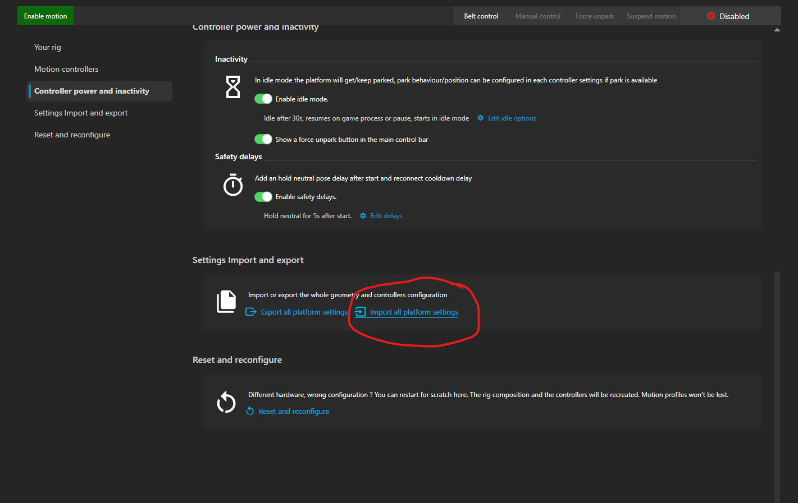
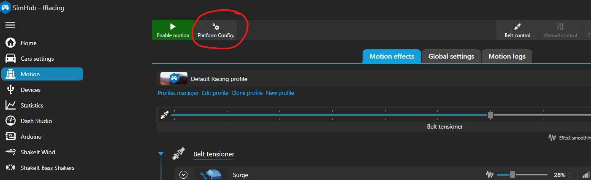
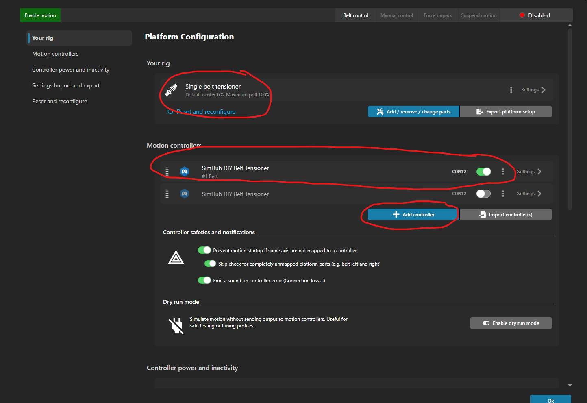
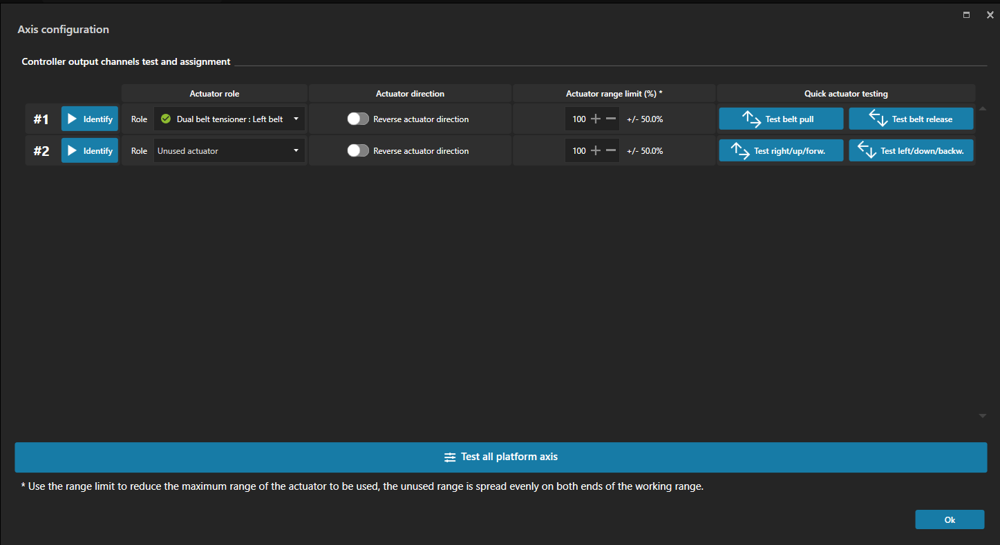
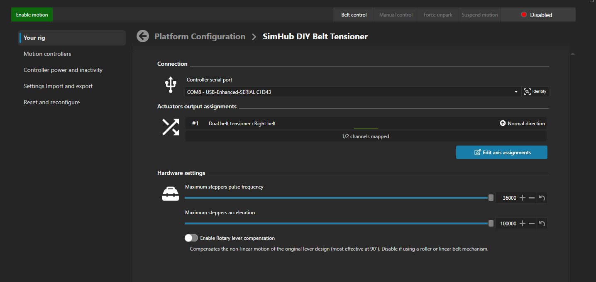
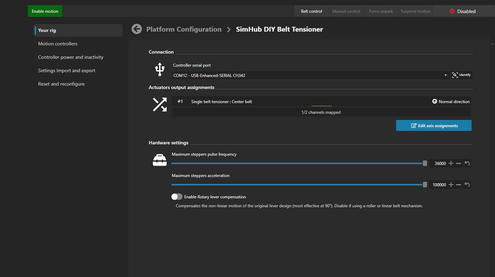

# SimHub Motion Plugin Setup Guide

This guide describes how to configure the official **SimHub Motion Plugin** for the DIY Active FFB Belt Tensioner.

---

## 🔑 Required: SimHub Motion License

The belt tensioner is driven by the **SimHub Motion** plugin, which requires a **SimHub licensed edition** together with the **Motion addon licence** (one-time purchase of **39€** on [SimHub](https://www.simhubdash.com/diy-belt-tensionner/)). The plugin includes a **20-minute free trial** per session for testing, but regular sim racing sessions need the licence.

To check your licence status, open **Motion** $\rightarrow$ **Global settings** $\rightarrow$ **Motion Addon Licence**. Both **SimHub licensed edition** and **Motion addon licence** must show a green check mark:

  

---

## ⚠️ Preliminary Step: SimHub Arduino Scan Settings

To prevent serial port conflicts and ensure stable communication with the **Motion** plugin, you must configure SimHub's built-in **Arduino** plugin so it does not probe the Belt Tensioner COM port:

1. Open **SimHub** and click on **Arduino** in the left sidebar menu.
2. Select the **My Hardware** tab at the top.
3. Under **ARDUINO SCAN SETTINGS**, choose one of the following methods:
   * **Method A (Recommended):** Select **Scan only selected ports** $\rightarrow$ Make sure your Belt Tensioner COM port (e.g. `COM12`) is **NOT** selected (shown red / disabled).
   * **Method B:** Select **Never scan selected ports** $\rightarrow$ Check/select your Belt Tensioner COM port (e.g. `COM12`) so SimHub never attempts to probe it as an Arduino device.
4. Click the **Apply changes** button.

  

---

## ⚡ Option A: Quick Setup (1-Click Import)

Pre-configured configuration files are provided in the [`docs/motionPluginSetup/`](motionPluginSetup/) folder, one for each rig variant:

| Rig variant | Preset file |
| :--- | :--- |
| **Single belt tensioner** (one actuator) | [`SingleAxisBeltTensioner.shmotionoutput`](motionPluginSetup/SingleAxisBeltTensioner.shmotionoutput) |
| **Dual belt tensioner** (two actuators, one controller board each) | [`DualAxisBeltTensioner.shmotionoutput`](motionPluginSetup/DualAxisBeltTensioner.shmotionoutput) |

1. Open **SimHub** and navigate to the **Motion** tab on the left.
2. Click **Platform Config.** in the top menu bar.
3. In the left sidebar, click on **Settings Import and export**.
4. Click **Import all platform settings** and select the preset file matching your rig from the table above.
5. Select your ESP32 COM port (baud rate: **`250000`**). The presets contain the COM ports of the author's rig, so always select your own port(s):
   * **Single:** select the port of your controller board.
   * **Dual:** the preset contains two enabled SimHub DIY Belt Tensioner controllers (left and right belt). Open each enabled controller's **Settings >** page and select the COM port of the matching board. Use **Test belt pull** in **Edit axis assignments** to check that each controller moves the correct belt (see Option B, Step 3, Variant 2).
6. Click **Enable Motion** $\rightarrow$ The carriage will automatically home against the physical stop, back off into the relaxed park position, and is ready for telemetry!

  

---

## 🛠️ Option B: Manual Step-by-Step Configuration

If you prefer to configure SimHub manually from scratch, follow these steps:

### Step 1: Open Platform Configuration
1. Open **SimHub** and select the **Motion** section on the left sidebar.
2. In the top bar, click the **Platform Config.** button.

  

---

### Step 2: Add Rig Rig Geometry & Motion Controller
1. Under **Your rig**, click **Add / remove / change parts** and choose **Single belt tensioner** (one actuator) or **Dual belt tensioner** (two actuators, one per shoulder belt).
2. Under **Motion controllers**, click **+ Add controller** and select **SimHub DIY Belt Tensioner**.
   * **Dual belt tensioner:** every actuator has its own controller board and COM port, so add **two** SimHub DIY Belt Tensioner controllers (one per board).
3. Enable the controller toggle switch(es).

  

---

### Step 3: Configure Serial Port, Actuator Mapping & Hardware Limits
Click on **Settings >** next to the **SimHub DIY Belt Tensioner** controller to open its detail page:

1. **Connection:**
   * Select your ESP32 serial port (e.g. `COM12 - CP2102 USB to UART Bridge` or `CH343`) with baud rate set to **`250000`**.
2. **Actuators output assignments** (click **Edit axis assignments**). Choose the variant matching your rig:

   **Variant 1: Single belt tensioner (one actuator)**
   * Map channel `#1` to **Single belt tensioner : Center belt** (Direction: **Normal direction**).

   **Variant 2: Dual belt tensioner (two actuators)**

   Each actuator runs on its own controller board, so configure each of the two SimHub DIY Belt Tensioner controllers separately and map **only one axis per actuator**:
   * **Controller of the left actuator:** channel `#1` $\rightarrow$ **Dual belt tensioner : Left belt**, channel `#2` $\rightarrow$ **Unused actuator**.
   * **Controller of the right actuator:** channel `#1` $\rightarrow$ **Dual belt tensioner : Right belt**, channel `#2` $\rightarrow$ **Unused actuator**.
   * Leave **Reverse actuator direction** off (Direction: **Normal direction**). Each controller page then shows **1/2 channels mapped**.
   * Use **Test belt pull** / **Test belt release** in the axis configuration to check that each actuator moves the correct belt in the correct direction.

  

  

3. **Hardware settings** (identical for single and dual setups, set them on every controller):
   * **Maximum steppers pulse frequency:** Set to **`36000`** (Maximum slider value).
     > *Note:* The firmware automatically applies a `5.28x` scaling factor to reach the peak pulse capability of **190,000 Hz** (~59.4 rev/s = ~593 mm/s) within the stable hardware limit of `FastAccelStepper`.
   * **Maximum steppers acceleration:** Set to **`100000`** (Maximum slider value).
     > *Note:* The firmware automatically applies a `60.0x` scaling factor to reach **6,000,000 steps/s²** for instantaneous torque and crisp, lag-free response.
   * **Enable Rotary lever compensation:** **OFF / Disabled** (Ensure this is turned off, as our design uses a direct linear rail / spindle mechanism).

  

---

### Step 4: Testing & Enabling Motion
1. Return to the main **Motion** screen in SimHub.
2. Click **Enable motion** in the top left green button.
3. The tensioner will execute its homing sequence against the physical stop, back off into the relaxed park position, and is ready for telemetry!
4. Adjust your desired telemetry motion effects (Surge, Deceleration, Sway, ABS vibration) in the **Motion effects** tab.
